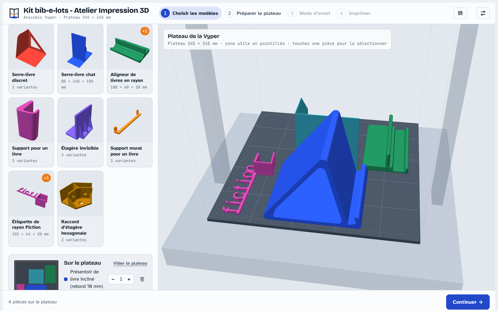

# Kit bib-e-lots - Atelier Impression 3D



Application web pour imprimer en 3D sans connaître le slicing, sur **Dagoma Neva** ou **Anycubic Vyper**.
Au lancement, l'usager touche l'imprimante posée devant lui ; l'atelier s'adapte à son plateau et à son mode d'emploi.
Tout se passe dans le navigateur, sans serveur.

Le parcours se fait en quatre étapes :

1. **Choix des modèles** dans un catalogue classé, avec un aperçu 3D.
2. **Aperçu du plateau**. Le placement est automatique sur le plateau rond Ø 180 mm. L'écran affiche aussi la durée, le poids et le coût du filament, et propose trois qualités : Rapide, Équilibré ou Fin.
3. **Mode d'envoi** : câble USB ou carte SD.
4. **Guide illustré pas à pas** pour le mode choisi.

## Télécharger l'application

Les versions de bureau sont dans les [Releases](https://github.com/biblioGironde/Kit-Impression3D-Atelier-Dagoma-Neva/releases) :

| Système | Fichier |
|---|---|
| macOS (Apple Silicon M1–M4) | `Atelier-Neva-…-mac-arm64.dmg` |
| macOS (Intel) | `Atelier-Neva-…-mac-x64.dmg` |
| Windows | `Atelier-Neva-…-windows-installation.exe` (installeur) ou `…-windows-portable.exe` (sans installation) |
| Linux | `Atelier-Neva-…-linux-x86_64.AppImage` ou `.tar.gz` |

L'application de bureau fonctionne **hors ligne** et propose toujours le **câble USB**, quel que soit le navigateur installé.

Les applications ne sont pas signées :

- **macOS** : au premier lancement, clic droit sur l'application → **Ouvrir**, puis confirmer. Si macOS indique que l'application est « endommagée », lancer dans le Terminal : `xattr -cr "/Applications/Atelier Neva.app"`.
- **Windows** : si SmartScreen s'affiche, cliquer sur **Informations complémentaires** → **Exécuter quand même**.
- **Linux** : rendre l'AppImage exécutable (`chmod +x Atelier-Neva-*.AppImage`).

## Version web

Le dossier se publie tel quel sur GitHub Pages (Settings → Pages → branche `main`, dossier racine). La page utile est `index.html`.

- **Mode USB** dans la version web : Web Serial API, donc Chrome ou Edge sur ordinateur, page servie en HTTPS.
- **Mode SD** : télécharge directement `dagoma0.g`.

## Ajouter vos modèles

Le code source est dans `src/`. Après une modification, régénérer `index.html` :

```
python3 build.py
```

Dans `src/catalog.js`, ajoutez une entrée au tableau `CATALOGUE` :

```js
{ id: 'hibou', nom: 'Hibou', categorie: 'Déco', fichier: 'modeles/hibou.stl',
  description: 'Un petit hibou de 6 cm.', conseil: 'Sans support.',
  credit: { auteur: 'Nom', licence: 'CC BY', source: 'Printables', url: 'https://…' } },
```

Pour un objet en plusieurs tailles, utilisez `variantes: [{ id, label, fichier }, …]` à la place de `fichier`.
Les fichiers STL doivent être en millimètres, posés à plat, Z vers le haut.

Pour tester un STL sans modifier le code : **Réglages animateur → Tester un fichier STL**.

## Imprimantes prises en charge

| | Dagoma Neva | Anycubic Vyper |
|---|---|---|
| Type | delta | cartésienne |
| Plateau | rond Ø 180 mm | 245 × 245 mm, chauffant |
| Hauteur utile retenue | 190 mm | 250 mm |
| Lancement depuis la carte | un appui sur le bouton | choix du fichier sur l'écran tactile |
| Fichier sur la carte | `dagoma0.g` | `atelier.gcode` |

Les profils sont dans `src/slicer.js` (`PROFILES`). Les réglages animateur sont enregistrés séparément pour chaque imprimante.

Pour remplacer les dessins de l'écran d'accueil par des photos de vos machines, ajoutez des images détourées sur fond transparent :
`imprimantes/neva.png` et `imprimantes/vyper.png`. Elles sont utilisées automatiquement si elles existent.

## Points à valider sur l'Anycubic Vyper

Le profil Vyper n'a pas encore été testé sur la machine. Vérifiez ces valeurs avant d'ouvrir l'outil au public :

| Réglage | Valeur actuelle | Où le changer |
|---|---|---|
| G-code de démarrage | chauffe plateau + buse, `G28`, `M420 S1` (nivellement enregistré), ligne de purge | Réglages animateur : collez l'en-tête d'un fichier produit par Cura avec le profil Vyper |
| Rétraction | 2 mm à 35 mm/s | `PROFILES.vyper.retract` dans `src/slicer.js` |
| Vitesse du port USB | 115200 bauds | Réglages animateur |
| Températures PLA | buse 205 °C, plateau 60 °C | Réglages animateur |
| Étapes sur l'écran tactile | « Imprimer » → choix du fichier → confirmer | texte du guide dans `src/app.js` |

## Points à valider sur votre Neva

Les valeurs ci-dessous sont des hypothèses raisonnables. Vérifiez-les avant d'ouvrir l'outil au public.

| Réglage | Valeur actuelle | Où le changer |
|---|---|---|
| Nom du fichier SD lu au bouton | `dagoma0.g` | Réglages animateur |
| G-code de démarrage (G28, G29…) | générique Marlin | Réglages animateur : collez l'en-tête d'un fichier Cura by Dagoma |
| Vitesse du port USB | 250000 bauds | Réglages animateur |
| Température PLA | 210 °C | Réglages animateur |
| Rétraction (Bowden) | 3,5 mm à 40 mm/s | `MACHINE.retract` dans le code |
| Zone utile du plateau | rayon 84 mm (marge de 6 mm pour la jupe) | `MACHINE.partRadius` |

Le moyen le plus sûr de régler la machine : trancher un petit modèle avec Cura by Dagoma, puis copier le début du fichier `.g` obtenu (jusqu'à `;LAYER:0`) dans le champ « G-code de démarrage ».

## Limites du moteur de découpe

Le moteur intégré produit des parois, des dessus et dessous pleins, un remplissage en lignes croisées et une jupe. Il ne génère **pas de supports**. Choisissez donc pour le catalogue des modèles imprimables sans support, avec des surplombs de 45° au maximum.

Les durées sont estimées à partir des vitesses programmées. L'écart réel est de l'ordre de 10 à 20 %.

## Catégorie « Objets en Bib »

15 objets pour la bibliothèque (présentoirs, serre-livres, étagères invisibles, signalétique), soit 29 fichiers STL dans `modeles/objets-en-bib/`.
Certains objets ont plusieurs variantes (tailles, côté gauche/droit) : on les choisit sur la fiche du modèle.

Tous sont sous licence Creative Commons. L'auteur, la licence et le lien source s'affichent sur chaque fiche ; le détail est dans `modeles/objets-en-bib/CREDITS.md`.
Les modèles MakerWorld sous « Standard Digital File License » n'ont pas été intégrés : leur licence interdit de redistribuer les fichiers.

La plupart de ces objets occupent une grande partie du plateau (Ø 180 mm) : comptez souvent un ou deux objets par impression.

## Construire l'application de bureau

```
npm install
npm start            # lancer en développement
npm run dist:linux   # ou dist:mac / dist:win
```

Pour publier une nouvelle version : changer `version` dans `package.json` et pousser sur `main`.
Le workflow GitHub Actions construit macOS, Windows et Linux et crée la release `v<version>`.

## Organisation du dépôt

| Dossier | Contenu |
|---|---|
| `index.html` | application web complète (générée par `build.py`) |
| `src/` | sources : interface, moteur de découpe, catalogue |
| `modeles/objets-en-bib/` | fichiers STL et `CREDITS.md` |
| `vendor/` | three.js r128 (licence MIT) et Clipper 6.4.2 (licence Boost) |
| `electron/` | application de bureau |
| `.github/workflows/` | construction des releases |
